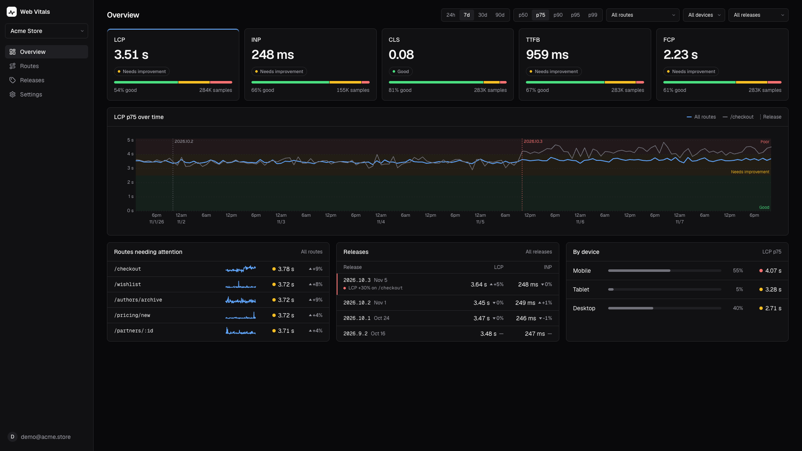
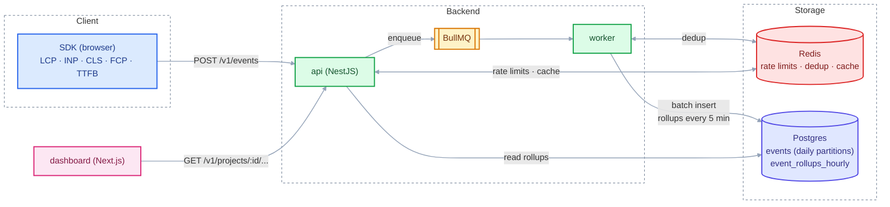

# web-vitals-monitor

Self-hosted real user monitoring (RUM) for Core Web Vitals. Lab tools like Lighthouse test a page on a single machine, so they miss what real users on real devices and networks experience. A small SDK collects LCP, INP, CLS, FCP and TTFB from real visitors' browsers, and the dashboard shows p75 values and rating breakdowns by route, device and release. The data stays on your own infrastructure.



## Architecture



The SDK batches metrics and sends them to the api, which checks the ingestion key and rate limits, then puts the batch on a BullMQ queue in Redis. The worker drops duplicate events using Redis, writes them into daily-partitioned `events` tables, and every 5 minutes recomputes the hourly rollups. Dashboard queries read the rollups through the api, which caches the responses in Redis.

## Getting started

Prerequisites: Node 24, pnpm (through corepack) and Docker.

```bash
git clone https://github.com/<your-username>/web-vitals-monitor.git
cd web-vitals-monitor
corepack enable
pnpm install

docker compose up -d   # Postgres and Redis
pnpm db:setup          # migrations + demo seed
pnpm dev               # api, worker and dashboard
```

`pnpm db:setup` runs the migrations and seeds a demo user with 3 projects and 10M events over 30 days. This takes a few minutes. The seed replaces any existing events.

- Dashboard: http://localhost:3000
- API: http://localhost:3001

Log in as `demo@acme.store` with the password `demo-password`.

## SDK usage

Create a project in the dashboard and copy its ingestion key. Then add the SDK to your site:

```ts
import { init } from '@web-vitals-monitor/sdk';

init({
  endpoint: 'http://localhost:3001/v1/events',
  key: '<ingestion-key>',
  release: '1.4.2', // optional: compare metrics between releases
});
```

The SDK reports each metric once its final value is known and sends batches with `navigator.sendBeacon` when the page is hidden, so it doesn't block rendering or navigation. Route and device type are detected automatically.
